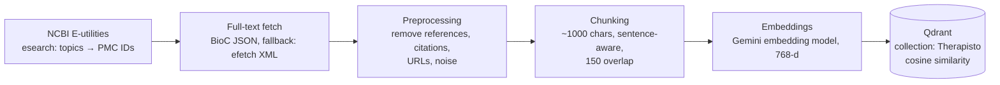
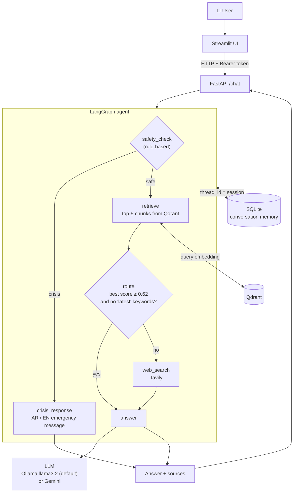

# 🧠 Therapisto

**An evidence-grounded mental health education assistant.**
Therapisto answers questions about anxiety, depression, trauma, sleep, and psychotherapy (e.g. CBT) using a
Retrieval-Augmented Generation (RAG) pipeline built on open-access scientific literature from PubMed Central (PMC),
with a built-in safety layer for crisis situations.

> ⚠️ **Disclaimer.** Therapisto is an educational tool. It is **not** a licensed therapist, does **not** diagnose,
> prescribe, or replace professional care. If you are in immediate danger, contact your local emergency services.

---

## Table of contents

1. [Features](#-features)
2. [Architecture](#-architecture)
3. [How a question is answered](#-how-a-question-is-answered)
4. [Tech stack](#-tech-stack)
5. [Project structure](#-project-structure)
6. [Getting started](#-getting-started)
7. [Configuration](#-configuration)
8. [Building the knowledge base](#-building-the-knowledge-base)
9. [API reference](#-api-reference)
10. [Safety design](#-safety-design)
11. [Limitations](#-limitations)
12. [Roadmap](#-roadmap)

---

## ✨ Features

- **RAG over scientific literature**: answers are grounded in retrieved PMC articles, with citations (PMCID + article URL).
- **Hybrid knowledge**: falls back to live **web search (Tavily)** when the knowledge base is not confident enough or the
  question asks for current guidance.
- **Safety-first design**: a rule-based crisis detector runs *before* any model call and returns an emergency response
  in Arabic or English.
- **Multi-turn memory**: conversation state persisted per session in SQLite via LangGraph checkpoints.
- **Bilingual**: responds in the user's language (Arabic / English).
- **Local or cloud LLM**: runs fully local with **Ollama** by default, or with **Gemini** by changing one setting.
- **Resilient ingestion**: rate-limit aware, retried, and resumable (no duplicate vectors on re-runs).

---

## 🏗 Architecture

### 1. Ingestion pipeline (offline, run once)



### 2. Runtime pipeline (online, per question)



### Components at a glance

| Layer | Responsibility |
|---|---|
| **Streamlit UI** | Chat interface, session handling, sources panel, RTL/LTR-aware rendering |
| **FastAPI** | Auth (Bearer token), CORS, request validation, calls the agent |
| **LangGraph agent** | Orchestrates safety → retrieval → routing → (web) → answer |
| **Qdrant** | Vector store for article chunks (cosine, 768 dimensions) |
| **Embeddings** | Gemini embedding model (document / query task types) |
| **LLM** | Local Ollama model by default; Gemini optional |
| **Tavily** | Web search fallback for fresh or missing information |
| **SQLite** | Persistent conversation history per session |

---

## 🔄 How a question is answered

1. **Safety check**: the question is scanned for crisis phrases (Arabic + English). If matched, the agent returns an
   emergency message immediately; no retrieval, no LLM call.
2. **Retrieve**: the question is embedded and the 5 most similar chunks are fetched from Qdrant.
3. **Route**: if the best similarity score is below the threshold (`0.62`), nothing relevant was found, or the user asks
   for *latest / current / guideline* information, the agent also runs a **web search**.
4. **Answer**: the LLM receives the system prompt (safety rules), recent history, retrieved sources, and instructions to
   answer directly, stay within the sources, and cite them.
5. **Respond**: the API returns the answer, the route taken, and the list of sources.

---

## 🧰 Tech stack

| Area | Technology |
|---|---|
| Language | Python 3.12 |
| Package manager | [uv](https://docs.astral.sh/uv/) |
| Agent orchestration | LangGraph, LangChain |
| LLM | Ollama (`llama3.2`), optionally Google Gemini |
| Embeddings | Google Gemini Embedding |
| Vector database | Qdrant Cloud |
| Web search | Tavily |
| Data source | NCBI PMC (E-utilities + BioC API), open-access subset |
| Backend | FastAPI + Uvicorn |
| Frontend | Streamlit |
| Memory | SQLite (LangGraph `SqliteSaver`) |

---

## 📁 Project structure

```text
Therapisto/
├── APP/
│   ├── config.py            # Settings loaded from .env (pydantic-settings)
│   ├── agent.py             # LangGraph workflow: safety, retrieve, route, web, answer
│   ├── main.py              # FastAPI app (/health, /chat)
│   └── ingest.py            # Ingestion script: PMC → clean → chunk → embed → Qdrant
├── data/
│   ├── first_source.py      # NCBI search + full-text fetch (BioC, efetch fallback)
│   ├── preprocessing.py     # Text cleaning (references, citations, noise)
│   ├── chunking.py          # Sentence-aware chunking with overlap
│   ├── vector_store.py      # Embeddings, Qdrant upsert/search, rate limiting, retries
│   └── test_search.py       # Quick retrieval sanity check
├── frontend/
│   └── app.py               # Streamlit chat UI
├── test.py                  # Run the agent from the terminal
├── pyproject.toml
├── .env                     # Local secrets (never commit)
└── README.md
```

---

## 🚀 Getting started

### Prerequisites

- Python 3.12+ and [uv](https://docs.astral.sh/uv/)
- [Ollama](https://ollama.com/) (for the local LLM)
- A [Qdrant Cloud](https://qdrant.tech/) cluster (free tier works)
- A Google AI Studio API key (used for embeddings)
- A [Tavily](https://tavily.com/) API key (web search)
- An [NCBI API key](https://www.ncbi.nlm.nih.gov/account/) (recommended for higher rate limits)

### Installation

```bash
git clone <your-repo-url>
cd Therapisto

# install dependencies
uv sync

# download the local model
ollama pull llama3.2
```

Create a `.env` file (see [Configuration](#-configuration)), then:

```bash
# 1) build the knowledge base (one time)
uv run python -m APP.ingest

# 2) start the backend
uv run uvicorn APP.main:app --port 8000

# 3) start the UI (in another terminal)
uv run streamlit run frontend/app.py
```

Open **http://localhost:8501**. Interactive API docs are at **http://localhost:8000/docs**.

---

## ⚙️ Configuration

Create a `.env` file in the project root. **Never commit it.**

```dotenv
# --- API keys ---
GOOGLE_API_KEY="your-google-ai-key"
TAVILY_API_KEY="tvly-..."
NCBI_API_KEY="your-ncbi-key"
NCBI_EMAIL="you@example.com"

# --- Qdrant ---
QDRANT_URL="https://<cluster-id>.<region>.aws.cloud.qdrant.io"
QDRANT_API_KEY="your-qdrant-key"
QDRANT_COLLECTION="Therapisto"

# --- LLM: "ollama" (local) or "gemini" (API) ---
LLM_PROVIDER="ollama"
OLLAMA_BASE_URL="http://localhost:11434"
OLLAMA_CHAT_MODEL="llama3.2"
OLLAMA_NUM_CTX=8192

# --- Gemini (embeddings always use Gemini) ---
GEMINI_EMBED_MODEL="gemini-embedding-2"
GEMINI_CHAT_MODEL="gemini-3.8-flash"
GEMINI_FALLBACK_MODELS=""

# --- Backend security ---
API_TOKEN="a-long-random-string"
ALLOWED_ORIGINS="http://localhost:8501,http://127.0.0.1:8501"
```

| Variable | Description |
|---|---|
| `LLM_PROVIDER` | `ollama` for a local model, `gemini` for the Gemini API |
| `OLLAMA_NUM_CTX` | Context window. Keep ≥ 8192 so the system prompt and retrieved chunks are not truncated |
| `QDRANT_COLLECTION` | Collection name. Its vector size must match the embedding size (768) |
| `API_TOKEN` | Shared secret between the UI and the API (`Authorization: Bearer <token>`) |
| `ALLOWED_ORIGINS` | Comma-separated origins allowed by CORS |

---

## 📚 Building the knowledge base

The ingestion script searches PMC for a list of topics (anxiety disorders, depression, CBT, PTSD, insomnia, …),
prefers review articles and meta-analyses, and stores the cleaned, chunked text in Qdrant.

```bash
uv run python -m APP.ingest
```

Design notes:

- **Open-access only**: only PMC open-access articles are fetched. Each chunk keeps its `pmcid`, title, and source URL.
- **Resumable**: chunk IDs are deterministic (UUIDv5 of article + chunk index), so re-running never creates duplicates
  and continues where it stopped.
- **Rate-limit aware**: requests to NCBI and the embedding API are throttled and retried with backoff.
- **Fail-fast**: the collection's vector size is validated before spending embedding quota.

To start over, delete the collection and re-run:

```bash
uv run python -c "from data.vector_store import qdrant; from APP.config import settings; qdrant.delete_collection(settings.qdrant_collection)"
```

Test retrieval quality:

```bash
uv run python -m data.test_search "What are the symptoms of anxiety?"
```

---

## 🔌 API reference

All endpoints except `/health` require `Authorization: Bearer <API_TOKEN>`.

### `GET /health`

```json
{ "status": "ok" }
```

### `POST /chat`

**Request**

```json
{
  "question": "What is cognitive behavioral therapy?",
  "session_id": "optional-existing-session-id"
}
```

**Response**

```json
{
  "answer": "Cognitive behavioral therapy (CBT) is ...",
  "session_id": "3f9c2b1e8d7a4c5f9a0b1c2d3e4f5a6b",
  "route": "answer",
  "sources": [
    {
      "type": "kb",
      "title": "…",
      "pmcid": "PMC10202820",
      "url": "https://pmc.ncbi.nlm.nih.gov/articles/PMC10202820/",
      "score": 0.711
    }
  ]
}
```

`route` is `answer` (knowledge base), `web` (web search was used), or `crisis` (safety response).
Reuse the returned `session_id` to continue the conversation.

**cURL example**

```bash
curl -X POST http://localhost:8000/chat \
  -H "Authorization: Bearer $API_TOKEN" \
  -H "Content-Type: application/json" \
  -d '{"question": "What are common symptoms of anxiety?"}'
```

---

## 🛡 Safety design

Mental health is a sensitive domain, so safety is built into the architecture rather than left to the model alone.

| Mechanism | What it does |
|---|---|
| **Pre-LLM crisis detector** | Rule-based Arabic/English phrase matching runs first; matches skip retrieval and the LLM entirely and return a fixed emergency message |
| **System prompt rules** | No diagnoses, no medication or dosage advice, no advice to stop treatment, no claims of replacing professionals |
| **Grounded answers** | The model is told to use only retrieved sources and to say so when evidence is insufficient |
| **Untrusted context** | Retrieved articles and web pages are treated as untrusted data and cannot override instructions |
| **Citations** | Answers cite PMCID / URL; invented references are prohibited |
| **API protection** | Bearer-token auth, restricted CORS, input length limits |

---

## ⚠️ Limitations

- **Small local models** (e.g. `llama3.2`, 3B) are weaker than hosted models, especially in Arabic dialects and in
  following long prompts. Always review citations. A larger model (`qwen2.5:7b`, `llama3.1:8b`) improves quality if your
  hardware allows it.
- The crisis detector is **phrase-based** and can miss indirect or unusual wording.
- Answer quality depends on the **coverage of the knowledge base**; topics not ingested fall back to web search.
- Retrieved research findings are **not clinical guidelines** and should not be treated as medical advice.
- Not evaluated in clinical settings.

---

## 🗺 Roadmap

- [ ] Streaming responses in the UI
- [ ] Model-based crisis classifier as a second safety layer
- [ ] Re-ranking (cross-encoder) and hybrid search (BM25 + vectors)
- [ ] Automated RAG evaluation (faithfulness, answer relevance, citation accuracy)
- [ ] Image understanding with a vision model
- [ ] Voice input/output
- [ ] Docker Compose deployment

---

## 📄 Data & licensing notes

Article text comes from the **PMC Open Access subset**. Each article keeps its own license; Therapisto stores the PMCID and
source URL with every chunk so answers can link back to the original paper. Check each article's license before
redistributing any content.

---

## 👩‍💻 Author
